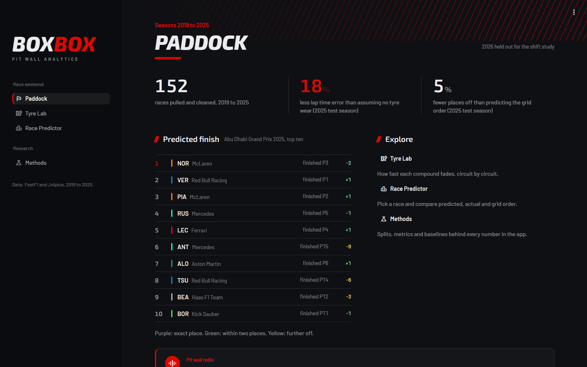
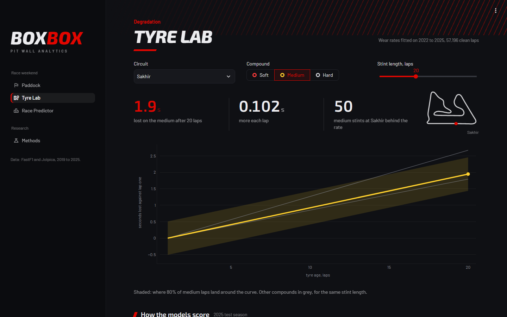
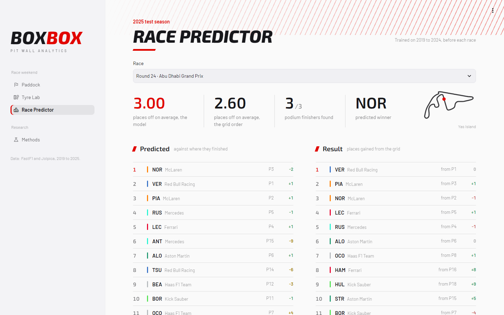

# BoxBox: Pit Wall Analytics

Tyre degradation modeling, race strategy simulation, and outcome prediction under the 2026 Formula 1 regulation change. DS5500 capstone, Northeastern University (Ashwin Satish, Joseph Russell).

## Overview

Pit stop strategy is one of the few race variables a Formula 1 team controls in real time. Choosing when to stop and which tyre compound to fit can gain or lose several positions. Teams make these calls with proprietary models, and there is no comparable public tool.

BoxBox is a pre race decision tool with two connected components:

* **Race outcome predictor:** estimates where each driver is likely to finish.
* **Strategy simulator:** shows how different pit strategies (one stop vs. two stop, undercut or overcut timing, responses to safety cars) shift those outcomes for a given driver, track, and starting position.

Both rest on a tyre degradation model: how much slower each lap gets as a tyre ages, per circuit and compound.

The 2026 season brought new power unit, aerodynamic, and tyre regulations. This gives a natural test of distribution shift: do models trained on earlier seasons still hold for the new cars?

## Results so far

Trained on earlier seasons, tested on 2025:

* **Tyre degradation:** predicts each lap within 0.62 s on average, against 0.76 s with no wear model. Wear is close to linear in tyre age, and running 1 to 1.5 s behind another car costs about 0.26 s a lap.
* **Finishing position:** 2.35 places average error, against 2.46 for grid order.
* **Key finding:** how fast tyres wear changes from race to race in ways nothing before the race predicts.

## Dashboard

A local Streamlit app (`streamlit run app/main.py`) with dark and light themes.



<p>
  
  
</p>

* **Paddock:** headline results, the predicted top ten for a race, safety car rates and pit loss by circuit.
* **Tyre Lab:** wear curve for any circuit, compound and stint length, with its uncertainty band and how each model scored.
* **Race Predictor:** predicted, actual and grid order for every 2025 race, with each driver's tyre strategy.
* **Methods:** the splits, metrics and baselines behind every number.

## Data

* [FastF1](https://github.com/theOehrly/Fast-F1): Python interface to the official F1 live timing archive. Lap and sector times, tyre compound and age, pit timings, track status, race control messages, and weather.
* [Jolpica F1 API](https://github.com/jolpica/jolpica-f1): race results, grids, and pit stop durations.

Race, sprint, qualifying, and the main long run practice session (FP2, or FP1 on sprint weekends) from 2019 to 2026 are extracted with local caching. 2018 is left out because it records seven named compounds (Hypersoft, Ultrasoft, ...) instead of event Soft, Medium, and Hard labels. Cleaned tables (laps, stints, results, qualifying, weather, pit stops) are stored as Parquet.

Training seasons per component: degradation uses 2022 to 2025 (the 18 inch tyre, ground effect era); the outcome predictor and pit loss use 2019 to 2025. 2026 is held out for the distribution shift study.

Derived quantities (one definition each, in `src/boxbox/features.py`):

* **Clean lap filter:** removes lap 1, in and out laps, safety car and virtual safety car laps, laps within 1 s of the car ahead, and outliers.
* **Fuel correction:** lap time with the estimated fuel mass effect removed (an assumption, since no fuel data is public: 100 kg burned evenly, 0.03 s per kg).
* **Wet races:** any car on intermediate or wet tyres.
* **Pit loss per circuit:** in lap plus out lap minus two normal laps, green flag stops only.
* **Long run pace:** practice stints with at least 5 representative laps.
* **Circuit key:** a stable track identifier across renamed venues and changed layouts.
* **Compounds:** modeled by the event's Soft, Medium, and Hard labels together with circuit and season, rather than Pirelli designations (C1, C2, ...). Pirelli numbers do not describe the same tyre over time: the 13 inch tyres were replaced by an 18 inch family in 2022, the 2022 C1 was renamed C0 in 2023, and C6 was added in 2025 and dropped in 2026. A small reference table of Pirelli designations for 2025 and 2026 flags circuits whose selection changed, for the distribution shift study.

## Approach

1. **Tyre degradation.** Lap time is a stint's own pace level plus a wear rate times tyre age. The level comes from each stint's first laps, so the wear rate is learned only from how lap times change within a stint, not from comparing fast and slow cars. Wear rates are estimated per circuit and compound and blended toward the compound average where history is thin. Compared against a quadratic and a smooth (GAM) wear curve, LightGBM, and a hierarchical Bayesian model (NumPyro) that learns how much circuits, races, teams and stints differ. Conformal intervals give every model a calibrated spread.
2. **Strategy simulation (next.** Total race time for each legal pit strategy from the degradation model, pit loss per circuit and sampled lap noise, with Monte Carlo for safety cars; later a full field version with a learned overtaking model, following Heilmeier et al. [4, 5].
3. **Outcome prediction.** Ridge regression ranking each race's classified finishers from information known before the start.
4. **Distribution shift.** Rehearse the method on the known 2021 to 2022 regulation change, then apply it to 2026: do the degradation curves and the predictor's errors shift, and how quickly can the models adapt?
5. **Dashboard.** Streamlit app combining the predictor and the simulator.

## Evaluation

* **Splits:** always by whole race or season. Rolling origin validation (train on the seasons before, score the next), with the last pre 2026 season (2025) as the test season.
* **Degradation:** per lap error of the anchored forecast above, by forecast horizon and compound; race by race paired bootstrap against the current model; interval coverage and quantile score.
* **Outcome predictor:** position MAE among classified finishers, Spearman correlation per race, podium and top 10 hit rates, against grid order.
* **Simulator:** replay historical dry races with the strategies teams actually used and compare simulated and observed race times; compare its recommended strategies with what the top finishers ran.
* **Distribution shift:** train on 2022 to 2025, test on completed 2026 races.

## Running it

```
pip install -r requirements.txt
pip install -e .
python scripts/pull_data.py        # raw sessions into data/interim, resumable, several hours the first time
python scripts/build_tables.py     # clean tables into data/processed
python -m pytest
```

Models (`--validation` scores the validation seasons only and leaves the test season unscored):

```
python scripts/train_degradation.py [--validation]   # choose and fit the degradation model, write data/models/
python scripts/train_outcome.py [--validation]       # finishing position predictor
```

Dashboard (after the models are trained):

```
python scripts/pull_data.py --track-maps   # optional: circuit outlines, about a minute
streamlit run app/main.py
```

Every threshold, assumption and model option lives in `config.yaml`: seasons per component, the clean lap filter, fuel burn, and switches for each degradation component (dirty air and race start terms, anchor level, which models are averaged, which get intervals), so each choice can be varied and reported.

## Repository layout

* `src/boxbox/`: `ingest.py` (pulls), `clean.py` (typed tables), `features.py` (all derived definitions), `pipeline.py`, `checks.py`, `evaluate.py` (season splits), `outcome.py` (finishing position predictor).
* `src/boxbox/degradation/`: one module per model family on a shared task: `task` (clean laps and the anchored forecast), `linear`, `gam` (quadratic and spline curves), `trees` (LightGBM), `bayes`, `ensemble` (averages), `intervals` (conformal), `adjust` (same weekend and in race updates), `compare`.
* `app/`: the Streamlit dashboard (pages in `views/`, shared pieces in `components/`, styling in `theme/`); its tables come from `src/boxbox/dashboard.py`.
* `scripts/`: entry points only.
* `tests/`: pytest on small synthetic data.
* `docs/images/`: dashboard screenshots for this README.
* `data/reference/`: hand filled reference tables (the only data in the repository).

## Limitations

* Fuel loads are not public, so fuel correction is an assumption; it shifts what is called wear but not the predicted lap times.
* Each race's own wear level cannot be predicted before the start (see above).
* The 2025 test season was scored several times while the degradation model was developed, so its numbers are somewhat optimistic; validation seasons drove every choice.
* The outcome predictor ranks classified finishers only; retirements are not modeled.
* Wet races are excluded from degradation and pit loss for now.

## References

1. FastF1. https://github.com/theOehrly/Fast-F1
2. Jolpica F1 API. https://github.com/jolpica/jolpica-f1
3. FIA. 2026 Formula 1 Technical Regulations, Section C.
4. A. Heilmeier, M. Graf, M. Lienkamp. A race simulation for strategy decisions in circuit motorsports. IEEE ITSC, 2018.
5. A. Heilmeier. Simulation of Circuit Races for the Objective Evaluation of Race Strategy Decisions. Dissertation, Technical University of Munich, 2022.
