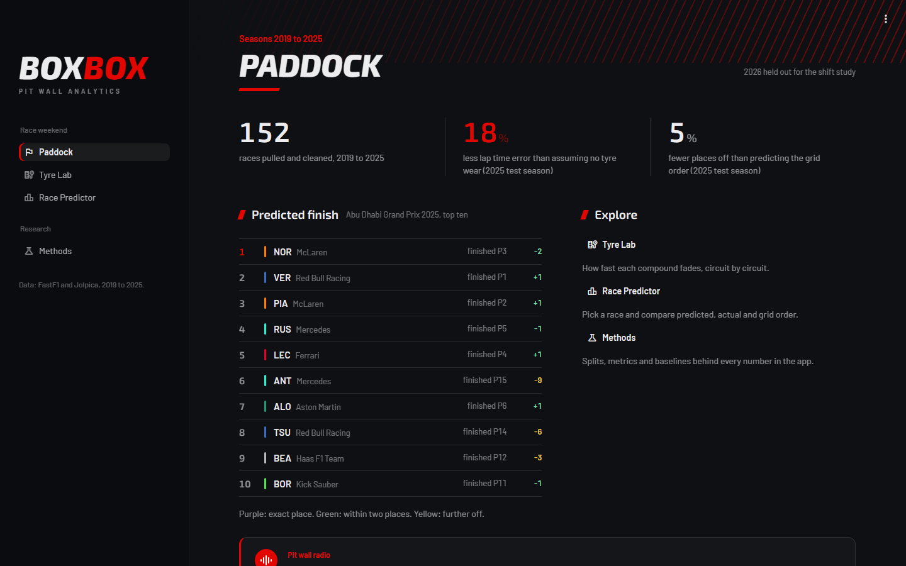
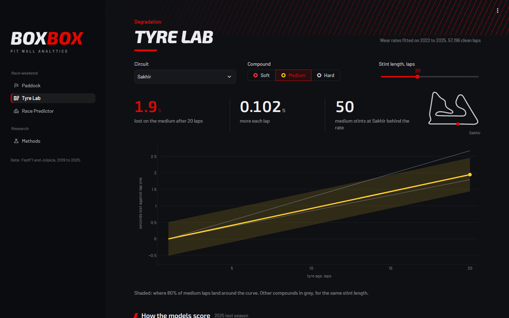
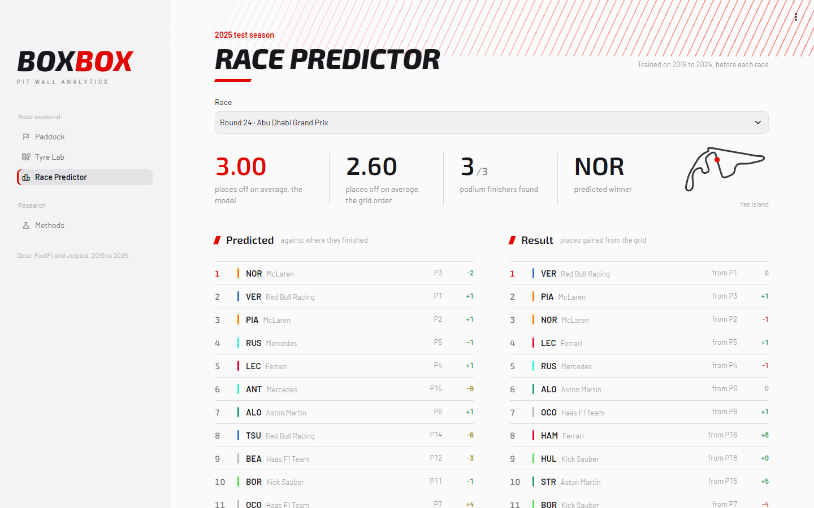

# BoxBox: Pit Wall Analytics

Tyre degradation modeling, race strategy simulation, and outcome prediction under the 2026 Formula 1 regulation change. DS5500 capstone, Northeastern University (Ashwin Satish, Joseph Russell).

## Overview

Pit stop strategy is one of the few race variables a Formula 1 team controls in real time. Choosing when to stop and which tyre compound to fit can gain or lose several positions. Teams make these calls with proprietary models, and there is no comparable public tool.

BoxBox is a pre race decision tool with two connected components:

* **Race outcome predictor:** estimates where each driver is likely to finish.
* **Strategy simulator:** shows how different pit strategies (one stop vs. two stop, undercut or overcut timing, responses to safety cars) shift those outcomes for a given driver, track, and starting position.

Both rest on a tyre degradation model: how much slower each lap gets as a tyre ages, per circuit and compound.

The 2026 season brought new power unit, aerodynamic, and tyre regulations. This gives a natural test of distribution shift: do models trained on earlier seasons still hold for the new cars?

## Results so far

Trained on earlier seasons, tested on 2025:

* **Tyre degradation:** predicts each lap within 0.66 s on average, against 0.76 s with no wear model (0.75 s for a no wear model that keeps the dirty air and race start terms, so wear itself is worth about 12%). Wear is close to linear in tyre age; the simulator uses a gently curved version held so a tyre never gets faster with age. Running 1 to 1.5 s behind another car costs about 0.26 s a lap.
* **Finishing position:** 2.35 places average error, against 2.46 for grid order.
* **Strategy simulator (v2):** with each car's real pace, real strategy and the race's real safety cars, it replays every dry 2025 race to within 1.84 places per driver, against 2.37 for grid order. With everything predicted before the race (car pace, rival strategies, safety cars) the error is 2.30 (v1: 2.46), slightly better than the grid; averaged with the finishing position predictor (0.75 simulator, 0.25 predictor) it is 2.28, level with the predictor (2.26) and 0.19 places better than v1 (95% interval 0.02 to 0.38). v1 could only race the green flag races (6 of 21 dry races in 2025).
* **Calling an undercut:** raced from the real race state just before the stop, the simulator predicts whether an undercut works (2023 and 2024, 94 attempts, 46% succeeded) far better than the base rate (Brier 0.218 against 0.258; AUC 0.71) and is calibrated on average, but a four variable logistic regression on the gap, the answer's delay, tyre ages and compounds still separates them better (Brier 0.192, AUC 0.80).
* **Strategy search against an expert:** Pirelli's race eve predicted fastest strategy matches the stop count the top three ran in 72% of races and their compounds in 63%; the search's fastest strategy matches 52% and 31%. Compound choice is the search's weak spot.
* **Wet races:** a scenario tool races them given a weather path (for example wet from lap 20, drying from lap 35), with rivals switching tyres in a wave like real fields do, and searches the best lap to switch. Switching one lap off the right moment costs about 1 s, two laps about 5 s, three about 11 s. Replaying 12 real wet races with real pace and strategies gives 1.81 places against 2.51 for grid order. It is not a forecast: there is no rain forecast input.
* **Key finding:** how fast tyres wear changes from race to race in ways nothing before the race predicts, and the fresh tyre gap between compounds moves from season to season (not explained by Pirelli's compound allocation).

## 2026 regulation change

Every model trained on 2022 to 2025 was scored on the first 17 rounds of 2026 (14 dry races at circuits with history), against the same models trained on 2022 to 2024 and scored on 2025. The method, declared before any 2026 data was read, was first checked on the known 2022 change, where it showed the shift clearly in the forecast bias and wear rates.

* **Tyre wear:** error rises from 0.66 to 0.70 s a lap and the forecasts become too fast by 0.20 s: the 2026 tyres wear more than the older seasons say, most on the Hard. Updating the model with the season's earlier races does not recover it.
* **Pit stops and neutralisations:** a stop costs about 0.9 s more than history says, and VSCs came in about two thirds of races against 38% expected.
* **Finishing position:** the predictor holds (2.18 places against 2.37 for grid order).
* **Simulator:** no system breaks; all beat grid order (fully predicted v2 2.10, v1 1.99, predictor 2.04, blend 2.07, grid 2.27), with the differences between them within noise.
* **Madrid** is reported apart: a new circuit with no history tests the fallback for unknown circuits rather than the regulation change. Its wear forecast was worse than assuming no wear (1.23 against 0.97 s). This exclusion was decided after the first 2026 run; the full season numbers are kept alongside.

## Dashboard

A local Streamlit app (`streamlit run app/main.py`) with dark and light themes.



<p>
  
  
</p>

* **Paddock:** headline results, the predicted top ten for a race, safety car rates and pit loss by circuit.
* **Tyre Lab:** wear curve for any circuit and compound, with its uncertainty band and how each model scored.
* **Race Predictor:** predicted, actual and grid order for every 2025 race, with each driver's tyre strategy.
* **Strategy Room:** for any 2025 dry race and driver, every strategy the search raced, ranked against what the driver ran, with a strategy builder that races a custom plan against the same field.
* **Overtaking:** how hard passing is, circuit by circuit, from the learned pass model.
* **Methods:** the splits, metrics and baselines behind every number.

## Data

* [FastF1](https://github.com/theOehrly/Fast-F1): Python interface to the official F1 live timing archive. Lap and sector times, tyre compound and age, pit timings, track status, race control messages, and weather.
* [Jolpica F1 API](https://github.com/jolpica/jolpica-f1): race results, grids, and pit stop durations.

Race, sprint, qualifying, and the main long run practice session (FP2, or FP1 on sprint weekends) from 2019 to 2026 are extracted with local caching. 2018 is left out because it records seven named compounds (Hypersoft, Ultrasoft, ...) instead of event Soft, Medium, and Hard labels. Cleaned tables (laps, stints, results, qualifying, weather, pit stops) are stored as Parquet.

Training seasons per component: degradation uses 2022 to 2025 (the 18 inch tyre, ground effect era); the outcome predictor and pit loss use 2019 to 2025. 2026 is held out for the distribution shift study.

Derived quantities (one definition each, in `src/boxbox/features.py`):

* **Clean lap filter:** removes lap 1, in and out laps, safety car and virtual safety car laps, laps within 1 s of the car ahead, and outliers.
* **Fuel correction:** lap time with the estimated fuel mass effect removed (an assumption, since no fuel data is public: 100 kg burned evenly, 0.03 s per kg).
* **Wet races:** any car on intermediate or wet tyres.
* **Pit loss per circuit:** in lap plus out lap minus two normal laps, green flag stops only.
* **Long run pace:** practice stints with at least 5 representative laps.
* **Circuit key:** a stable track identifier across renamed venues and changed layouts.
* **Compounds:** modeled by the event's Soft, Medium, and Hard labels together with circuit and season, rather than Pirelli designations (C1, C2, ...). Pirelli numbers do not describe the same tyre over time: the 13 inch tyres were replaced by an 18 inch family in 2022, the 2022 C1 was renamed C0 in 2023, and C6 was added in 2025 and dropped in 2026. A small reference table of Pirelli designations for 2025 and 2026 flags circuits whose selection changed, for the distribution shift study.

## Approach

1. **Tyre degradation.** Lap time is a stint's own pace level plus a wear rate times tyre age. The level comes from each stint's first laps, so the wear rate is learned only from how lap times change within a stint, not from comparing fast and slow cars. Wear rates are estimated per circuit and compound and blended toward the compound average where history is thin. Compared against a quadratic and a smooth (GAM) wear curve, LightGBM, and a hierarchical Bayesian model (NumPyro) that learns how much circuits, races, teams and stints differ. Conformal intervals give every model a calibrated spread.
2. **Strategy simulation.** A lap by lap Monte Carlo race of the whole field, following Heilmeier et al. [4, 5]. Version 1 covers dry, green flag races with no retirements.
   * **Lap times:** each car's free air lap is its base pace plus fuel, the compound gap, tyre wear, track evolution, a race start offset and lap noise. Running 1 to 3 s behind another car adds the dirty air cost, and each stop adds a pit loss drawn for the circuit.
   * **Car pace:** ridge regression on qualifying gap, grid slot and the driver's and team's recent finishing form, with each car's pace drawn from the model's error (about half of it shared by teammates) so rivals are not known exactly. Each race's reference lap time comes from its own qualifying.
   * **Safety cars and VSCs:** drawn per lap from a hazard model fitted on 2019 onward (lap 1 apart, circuits pulled toward the all circuit rate). Under a safety car the field closes into a train in about two laps, lines up at the measured restart gaps (median 0.45 s) and nobody passes; under a VSC everyone slows by the same share; a stop under either costs about half or three quarters of a green flag stop, and a tyre change under a red flag is free, all measured from the data.
   * **Pit loss:** the circuit's median green flag stop, corrected for pit lane speed limit changes (lane length over limit), which catches the faster Marina Bay and Zandvoort pit lanes of 2025.
   * **Rival strategies:** either the real ones (for backtests) or drawn from a pit decision model, which picks a plan (1, 2 or 3+ stops), times the stops lap by lap and chooses each new compound under the two compound rule. Rivals pit under safety cars and VSCs at the rate the data shows, and the car ahead answers a rival's stop by pitting next lap about three times as often as its tyres alone explain. A user can also set any car's strategy.
   * **Overtaking:** a rule. A car within 1 s of the car ahead passes if its pace advantage, less the gap, beats a threshold for that circuit, set so the rule reproduces the circuit's real pass rate (from Monaco's 0.6% of close laps to Barcelona's 25%). Otherwise the car is held about 0.5 s behind. A learned pass probability (logistic regression on pace advantage, gap, circuit, tyre age and compound differences and laps already stuck behind) predicts single passes far better (log loss 0.25 against 0.39 for circuit pass rates) but does not replay finishing places better inside the race, so the rule stays and the model is a switch.
   * **Strategy search:** for one driver, every legal strategy is raced against the same rival, safety car and noise draws. Stint lengths are capped per circuit and compound at what teams have run (tighter where teams rarely run a compound), a planned stop moves onto an early safety car, and rivals may answer the stop. Strategies whose finishing place is within a quarter place of the best are reported as near ties, and each draw uses a tyre model refitted on resampled races, with a race level spread in the compound gaps.
3. **Outcome prediction.** Ridge regression ranking each race's classified finishers from information known before the start.
4. **Distribution shift.** Rehearse the method on the known 2021 to 2022 regulation change, then apply it to 2026: do the degradation curves and the predictor's errors shift, and how quickly can the models adapt?
5. **Dashboard.** Streamlit app combining the predictor and the simulator.

## Evaluation

* **Splits:** always by whole race or season. Rolling origin validation (train on the seasons before, score the next), with the last pre 2026 season (2025) as the test season.
* **Degradation:** per lap error of the anchored forecast above, by forecast horizon and compound; race by race paired bootstrap against the current model; interval coverage and quantile score.
* **Outcome predictor:** position MAE among classified finishers, Spearman correlation per race, podium and top 10 hit rates, against grid order.
* **Simulator:** replay green flag dry races from the real grid and score finishing position MAE among classified finishers, against grid order and the finishing position predictor. Variants separate the engine from its inputs: real or predicted car pace, real or pit model strategies, and the overtaking rule against a single global threshold, free passing and no passing. The strategy search is checked against what the top three finishers ran.
* **Passing rule and car pace:** chosen on the validation seasons by the error in passes per race and in percent pace.

| Simulator place MAE, every dry race | 2023 | 2024 | 2025 (test) |
|---|---|---|---|
| Real pace, strategies and safety cars | 2.00 | 1.73 | 1.84 |
| Everything predicted (v2) | 2.40 | 2.10 | 2.30 |
| Everything predicted (v1 system) | 2.47 | 2.10 | 2.46 |
| 0.75 simulator + 0.25 predictor | 2.30 | 2.10 | 2.28 |
| Finishing position predictor | 2.34 | 2.09 | 2.26 |
| Grid order | 2.91 | 2.35 | 2.37 |

Places among classified finishers. 2023 and 2024 are validation seasons (choices made there). 2025 was scored once after every choice, then once more after the track evolution fix chosen on validation (the 2025 column shows the second look; validation columns are from before the fix, which moved pooled validation places by under 0.02).
* **Distribution shift:** train on 2022 to 2025, test on completed 2026 races, against the same models trained on 2022 to 2024 and scored on 2025; rehearsed on the 2022 change (train 2019 to 2021).

## Running it

```
pip install -r requirements.txt
pip install -e .
python scripts/pull_data.py        # raw sessions into data/interim, resumable, several hours the first time
python scripts/build_tables.py     # clean tables into data/processed
python -m pytest
```

Models (`--validation` scores the validation seasons only and leaves the test season unscored):

```
python scripts/train_degradation.py [--validation]   # choose and fit the degradation model, write data/models/
python scripts/train_outcome.py [--validation]       # finishing position predictor
python scripts/train_pit_decision.py [--validation]  # rival pit model
python scripts/train_simulator.py [--validation]     # passing rule, car pace and the other simulator inputs
python scripts/backtest_simulator.py [--validation | --test-only] [--green] [--search]   # replay every dry race, paired intervals; --search checks the strategy search (slow)
python scripts/build_strategy_room.py && python scripts/build_overtaking.py   # dashboard data for the Strategy Room and Overtaking pages
python scripts/shift_study.py --rehearsal | --study   # distribution shift: rehearsal on 2021 to 2022, then 2022 to 2025 vs 2026
python scripts/build_shift_page.py                   # dashboard data for the 2026 Shift page
python scripts/study_wet.py                          # wet races: intermediate wear and the slick to intermediate crossover
```

Dashboard (after the models are trained):

```
python scripts/pull_data.py --track-maps   # optional: circuit outlines, about a minute
streamlit run app/main.py
```

Every threshold, assumption and model option lives in `config.yaml`: seasons per component, the clean lap filter, fuel burn, and switches for each degradation component (dirty air and race start terms, anchor level, which models are averaged, which get intervals), so each choice can be varied and reported.

## Repository layout

* `src/boxbox/`: `ingest.py` (pulls), `clean.py` (typed tables), `features.py` (all derived definitions), `pipeline.py`, `checks.py`, `evaluate.py` (season splits), `outcome.py` (finishing position predictor).
* `src/boxbox/degradation/`: one module per model family on a shared task: `task` (clean laps and the anchored forecast), `linear`, `gam` (quadratic and spline curves), `trees` (LightGBM), `bayes`, `ensemble` (averages), `intervals` (conformal), `adjust` (same weekend and in race updates), `compare`; for the simulator, `monotone` (wear that never falls with age), `compound` (fresh tyre gaps between compounds) and `noise` (lap noise shared by a stint and a race). `src/boxbox/pitloss.py`: pit loss per circuit.
* `src/boxbox/pitdecision.py`: the rival pit model (stop plan, lap by lap stop timing, tyre choice). `src/boxbox/overtaking.py`: close pairs from real races and the passing rule.
* `src/boxbox/simulator/`: `laptime` (the lap time model), `pace` (car pace), `strategy` (real, model and user strategies, legal strategies, stint caps), `race` (the race engine and strategy search), `inputs` (everything fitted, saved as one file), `backtest`.
* `app/`: the Streamlit dashboard (pages in `views/`, shared pieces in `components/`, styling in `theme/`); its tables come from `src/boxbox/dashboard.py`.
* `scripts/`: entry points only.
* `tests/`: pytest on small synthetic data.
* `docs/images/`: dashboard screenshots for this README.
* `data/reference/`: hand filled reference tables (the only data in the repository).

## Limitations

* Fuel loads are not public, so fuel correction is an assumption; it shifts what is called wear but not the predicted lap times.
* Each race's own wear level cannot be predicted before the start (see above).
* 2026 covers rounds 1 to 17 so far; later rounds need a FastF1 login to the F1 timing server.
* The 2025 test season was scored several times while the degradation model was developed, so its numbers are somewhat optimistic; validation seasons drove every choice.
* The outcome predictor ranks classified finishers only; retirements are not modeled.
* Wet races are excluded from degradation, pit loss and the backtests. The wet scenario tool models the track by lap rather than by how wet it is, reuses the dry pit loss, safety car and passing models, and rests on 12 wet races.
* The simulator has no retirements or lap 1 position changes, and sampled red flags are raced as safety cars (in replays of real red flags the tyre change is free). Rivals react to safety cars and answer a stop, but to nothing else.
* The strategy search favours Soft stints where teams run Hards (Monza, Austin, Spa): the tyre inputs likely overrate Softs on long stints. The real strategy of a top three finisher is among the search's near ties only 19 to 37% of the time.
* The simulated field runs within 1 s of the car ahead 1.1 to 1.3 times as often as real races. The passing rule's pass count is right partly because each stint's random wear reaches the pace gap it reads; reading the model's pace gap, which the rule is fitted on, makes the field bunch (an errors in variables problem).
* Predicting the finishing order is limited by car pace and race events: the v2 simulator's own gain over v1 on predicted places is within noise, and fresh tyre gaps between compounds still move a lot from season to season, so the strategy search agrees with what the top three ran only about a third of the time.

## References

1. FastF1. https://github.com/theOehrly/Fast-F1
2. Jolpica F1 API. https://github.com/jolpica/jolpica-f1
3. FIA. 2026 Formula 1 Technical Regulations, Section C.
4. A. Heilmeier, M. Graf, M. Lienkamp. A race simulation for strategy decisions in circuit motorsports. IEEE ITSC, 2018.
5. A. Heilmeier. Simulation of Circuit Races for the Objective Evaluation of Race Strategy Decisions. Dissertation, Technical University of Munich, 2022.
